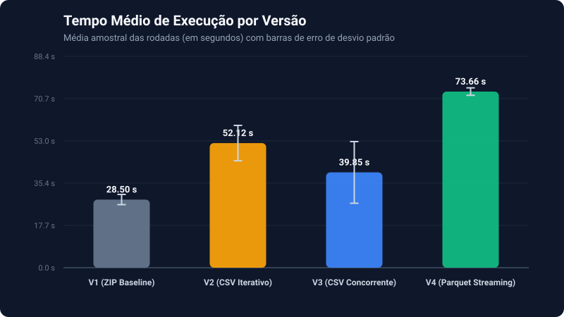
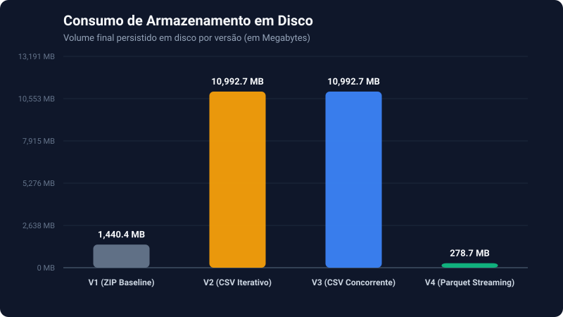
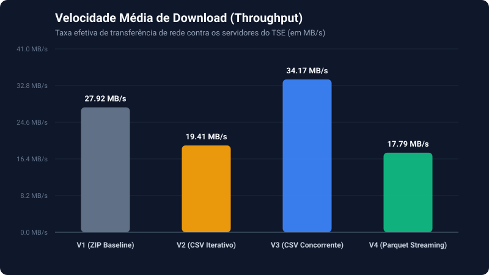
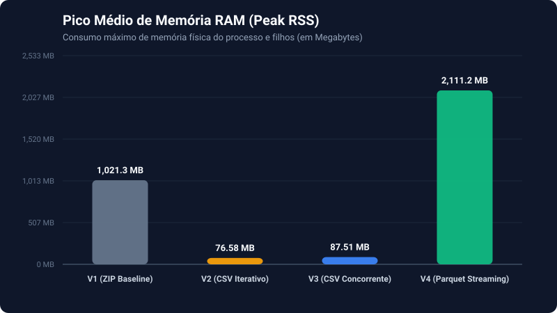
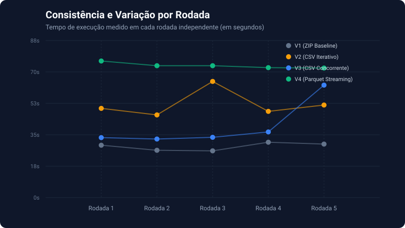

# 🔬 Benchmark de Desempenho e Armazenamento: `opt-tse-analytics`

> **Estudo Experimental de Engenharia de Software, Otimização de I/O e FinOps em Pipelines de Dados**  
> Repositório Principal de Engenharia: [**opt-tse-analytics**](https://github.com/lucaspedrom/opt-tse-analytics)

[](https://www.python.org/)
[](https://github.com/astral-sh/uv)
[](https://parquet.apache.org/)
[](#-metodologia-científica-experimental)

---

## 📌 Sumário Executivo

Este repositório documenta a suíte de testes, metodologia experimental e resultados consolidados do benchmark de desempenho realizado sobre as versões evolutivas do projeto **`opt-tse-analytics`**.

O objetivo primordial do projeto foi transformar uma abordagem sequencial e pesada de extração de dados — que descompactava quase **11 GB de arquivos CSV em disco**, impondo um severo gargalo de I/O e armazenamento — em uma esteira analítica moderna, com concorrência otimizada e processamento em *streaming in-memory*. A versão final entrega dados tipados, particionados e prontos para consulta (*Analytics-Ready*) em formato **Apache Parquet**, reduzindo o armazenamento final para apenas **278 MB** (**economia de 97,5% em disco**).

Para comprovar formalmente os ganhos de engenharia e evitar métricas ilusórias (*vanity metrics*), desenvolveu-se esta suíte de testes independente com **10 rodadas em bloco casualizado (RCBD)**, isolamento por `git worktree` e amostragem contínua de recursos (CPU, RAM, Rede e Disco) via `psutil`.

---

## 🏗️ Evolução Arquitetural das Versões Avaliadas

Foram submetidas a teste **4 versões históricas** do projeto, representando saltos arquiteturais fundamentais:

| Versão | Commit | Estratégia de Ingestão | Processamento / Concorrência | Formato do Entregável | Estado do Dado |
| :---: | :---: | :--- | :--- | :--- | :--- |
| **V1** | `e010a7f` | Download direto HTTP via `requests` | Sequencial (1 thread, sem pooling) | Arquivos `.zip` compactados | ❌ **Inacessível** (Binário fechado, exige descompactação downstream) |
| **V2** | `d082d9b` | Descompactação do ZIP em streaming | Sequencial (1 thread, catálogo de datasets) | Arquivos `.csv` em disco | ⚠️ **Bruto Acessível** (Dado aberto, porém volumoso e sem tipagem) |
| **V3** | `0485406` | Connection Pool HTTP + Retries com Backoff | `ThreadPoolExecutor` com escalonamento **LPT** | Arquivos `.csv` em disco | ⚠️ **Otimizado** (Mesmo CSV da V2, com redução expressiva de latência de rede) |
| **V4** | `a980086` | Ingestão, descompressão e parsing *in-memory* | Pipeline colunar vetorial em streaming (`pyarrow`) | **Apache Parquet** particionado | ✅ **Analytics-Ready** (Tipado, colunar, indexado e pronto para DuckDB/Athena) |

---

## 🔬 Metodologia Científica Experimental

Para inibir variáveis de confusão externas (latência flutuante da CDN do TSE, escalonamento térmico de processador, *caching* do sistema de arquivos do SO e reuso de memória), adotou-se o seguinte protocolo:

1. **Randomized Complete Block Design (RCBD):**
   A cada rodada de teste, a ordem de execução das 4 versões foi **sorteada aleatoriamente** (`random.shuffle`). Isso garante que flutuações pontuais de largura de banda externa ou carga do SO afetem todas as versões de forma distribuída.
2. **Isolamento de Estado com `git worktree`:**
   Cada versão foi executada a partir de um *worktree* dedicado apontando para seu respectivo *hash* de commit, compartilhando a base do Git sem mistura de código e sem resíduos de arquivos não rastreados.
3. **Ambiente Virtual Unificado (`uv run --python`):**
   Utilizou-se o runtime de alta performance do `uv` apontando para o ambiente virtual compartilhado (`bench_v4/.venv`), garantindo que todas as versões executassem exatamente sob o mesmo interpretador Python e mesmas versões de bibliotecas base.
4. **Isolamento e Quarentena de Dados (Clean Snapshot):**
   Antes de cada teste, o orquestrador mapeia o estado dos arquivos (`snapshot`). Ao término, os novos dados gerados são mensurados em bytes, contabilizados e **imediatamente movidos** para a pasta da rodada (`results/rodada_X/{versao}/`), seguido da limpeza forçada de diretórios residuais. O worktree permanece 100% limpo para o teste seguinte.
5. **Cooldown e Esgotamento de Sockets TCP:**
   Entre cada execução individual, foi estabelecido um intervalo obrigatório de **15 segundos** (*cooldown*). Isso permite fechar *sockets* de rede em estado `TIME_WAIT` e estabilizar a temperatura e frequência do processador.
6. **Amostragem em Tempo Real de Recursos com `psutil`:**
   O orquestrador monitora de forma assíncrona o consumo de CPU (média e pico) e o pico de consumo de memória física (Peak RSS) de toda a árvore de subprocessos, além do tráfego bruto recebido pela placa de rede e a velocidade média de download em MB/s.

---

## 💻 Ambiente e Especificações de Execução

Todas as métricas foram coletadas na mesma máquina e registradas em [`results/environment.json`](results/environment.json):

* **Processador (CPU):** Intel64 Family 6 Model 183 Stepping 1, GenuineIntel (10 núcleos físicos / 16 lógicos)
* **Memória RAM:** 23.69 GB Total
* **Sistema Operacional:** Microsoft Windows 11 Pro (Build 10.0.26300)
* **Interpretador Python:** 3.13.11
* **Gerenciador de Pacotes e Runtime:** uv 0.9.17
* **Comando Padronizado:** `uv run --python "..." python main.py -i 2014 -f 2022 --intervalo 4`
* **Escopo de Dados Testado:** 3 anos eleitorais (2014, 2018 e 2022) em 5 conjuntos de dados distintos (`candidatos`, `bens_candidatos`, `coligacoes`, `motivo_cassacao`, `votacao_candidato_municipio_zona`).

---

## 📊 Resultados Consolidados

Abaixo estão os resultados consolidados a partir da bateria completa de **10 rodadas experimentais** (40 execuções isoladas):

| Versão | Tempo Médio | Tempo Mediana | Desvio Padrão ($\sigma$) | Armazenamento Final | Pico RAM Médio | CPU Média | Download Médio | Entregável Final |
| :---: | :---: | :---: | :---: | :---: | :---: | :---: | :---: | :--- |
| **V1** | 56,08s | 60,20s | 12,43s | **1.440,36 MB** (~1,44 GB) | 1.021,29 MB | 14,02% | 27,92 MB/s | 15 ZIPs compactados brutos |
| **V2** | 77,02s | 79,41s | 12,02s | **10.992,69 MB** (~10,99 GB) | **76,58 MB** | 17,05% | 19,41 MB/s | 15 CSVs extraídos em disco |
| **V3** | **44,91s** | **47,12s** | 6,98s | **10.992,69 MB** (~10,99 GB) | 87,51 MB | 14,04% | **34,17 MB/s** | 15 CSVs extraídos em disco |
| **V4** | 84,20s | 86,09s | **5,88s** | **278,72 MB** (~0,28 GB) | 2.111,22 MB | **10,49%** | 17,79 MB/s | **Partições Apache Parquet** |

> Os dados brutos detalhados de cada execução encontram-se em [`results/benchmark_raw.csv`](results/benchmark_raw.csv) e o consolidado em [`results/benchmark_summary.csv`](results/benchmark_summary.csv).

---

## 📈 Visualizações do Benchmark

### 1. Tempo Médio de Execução (com Barras de Desvio Padrão)


### 2. Consumo de Armazenamento em Disco (MB)


### 3. Velocidade Média de Download (Throughput de Rede)


### 4. Pico Médio de Memória RAM (Peak RSS)


### 5. Consistência e Previsibilidade entre as 10 Rodadas


---

## 💡 Análise Crítica e Trade-offs de Engenharia

### 1. A Falácia da Métrica de Vaidade (V1)
A **V1** registra um tempo médio de **56,08s** e download a **27,92 MB/s**, parecendo rápida à primeira vista. No entanto, **a V1 não entrega valor analítico**: ela simplesmente efetua o download cego do arquivo `.zip` para o disco. 
Todo o trabalho computacional pesado — descompactação, validação e carregamento de dados — foi delegado para o usuário ou elo seguinte da esteira, gerando um débito técnico severo e deixando 1,44 GB de binários fechados.

### 2. O Preço da Disponibilidade do Dado (V1 ➔ V2)
A **V2** implementa a extração necessária para que os dados fiquem legíveis em formato aberto (`.csv`). Essa mudança revela o custo oculto de lidar com dados em texto puro descompactados:
* O tempo de execução salta para **77,02s** (mediana de **79,41s**), com o maior uso médio de processador da suíte (**17,05%** de CPU).
* O armazenamento explode de **1,44 GB para quase 11 GB** (um aumento de **7,6x**).
* A velocidade média de download cai para **19,41 MB/s** em decorrência do gargalo severo de *I/O de disco*, onde a CPU e o barramento gastam ciclos descompactando e gravando múltiplos gigabytes de texto em disco em concorrência com a recepção da rede.

### 3. Eficiência de Concorrência e Pooling (V2 ➔ V3)
Ao manter rigorosamente o mesmo produto final da V2 (os mesmos 11 GB de CSVs), a **V3** implementa **Connection Pooling HTTP**, **`ThreadPoolExecutor`** e o algoritmo de escalonamento **Longest Processing Time (LPT)**:
* **A V3 se torna a versão mais rápida em tempo absoluto**, com média de **44,91s** e mediana de **47,12s**.
* Isso representa uma **redução de 41,7% no tempo médio** frente à V2 (de 77,0s para 44,9s).
* O throughput de download salta de 19,41 MB/s (V2) para **34,17 MB/s (V3)** — um **ganho de vazão de 76%** decorrente do reuso de conexões TCP já abertas e do paralelismo de arquivos.
* O desvio padrão cai quase pela metade (de 12,02s para **6,98s**), garantindo maior confiabilidade de rede.

### 4. A Revolução do Streaming Colunar em Memória (V3 ➔ V4)
A **V4** é o ápice arquitetural do projeto, reformulando o fluxo de dados para o padrão moderno de Engenharia de Dados:
* **Redução de 97,5% no consumo de disco:** O volume gerado cai drasticamente de **10.992 MB para apenas 278,72 MB**.
* **Menor que o próprio arquivo compactado original:** Os 278 MB de Parquet particionado ocupam **80,6% menos espaço do que os arquivos ZIP originais da V1 (1.440 MB)**, provando a superioridade da compressão colunar com dicionários e *bit-packing*.
* **Extrema Previsibilidade Operacional:** A V4 apresentou o **menor desvio padrão de todas as versões ($\sigma = 5,88s$)**, garantindo um tempo estável em torno de 84s.
* **O Trade-off de Engenharia (RAM vs Disco):** Para alcançar essa economia massiva de armazenamento sem sacrificar a máquina com arquivos intermediários, a V4 realiza o parsing, descompressão e estruturação colunar do Arrow inteiramente em memória RAM. O pico de RAM médio atingiu **2.111 MB (~2,1 GB)**, mas em contrapartida registrou o **menor consumo médio de CPU da suíte (10,49%)** e eliminou totalmente o I/O de disco temporário.
* **Impacto em FinOps:** Em ambientes de nuvem (AWS S3, Google Cloud Storage, Athena, BigQuery ou DuckDB), uma redução de 97,5% em bytes armazenados e escaneados resulta em **economias proporcionais imediatas nas faturas de armazenamento e consulta analítica**.

---

## 🚀 Como Reproduzir o Benchmark

### 1. Pré-requisitos
* Sistema com [**uv**](https://github.com/astral-sh/uv) instalado.
* Repositório clonado e diretórios *worktrees* configurados como pastas irmãs:

```
D:\Projetos/
├── opt-tse-analytics/   # Repositório original com histórico Git
├── bench_v1/            # Worktree commit e010a7f
├── bench_v2/            # Worktree commit d082d9b
├── bench_v3/            # Worktree commit 0485406
├── bench_v4/            # Worktree commit a980086
└── benchmark_suite/     # Este repositório (benchmark-opt-tse-analytics)
```

Para recriar os worktrees a partir da raiz do `opt-tse-analytics`:
```bash
git worktree add ../bench_v1 e010a7f
git worktree add ../bench_v2 d082d9b
git worktree add ../bench_v3 0485406
git worktree add ../bench_v4 a980086
```

### 2. Executando o Benchmark

Para rodar a bateria completa com 10 rodadas (padrão) e monitoramento de sistema:
```powershell
cd D:\Projetos\benchmark_suite
uv run benchmark_runner.py --rodadas 10 --cooldown 15
```

Para rodar um teste piloto rápido de 1 rodada (*dry-run*):
```powershell
uv run benchmark_runner.py --dry-run
```

Para rodar apenas um subconjunto de versões (ex.: comparar apenas V3 e V4):
```powershell
uv run benchmark_runner.py --versoes v3 v4 --rodadas 5
```

### 3. Atualizando os Gráficos
Após a conclusão dos testes, execute o gerador para atualizar as imagens em [`results/charts/`](results/charts/):
```powershell
uv run generate_charts.py
```

---

## 📁 Estrutura do Repositório

```text
benchmark-opt-tse-analytics/
├── .gitignore               # Exclui dezenas de GBs de dados brutos extraídos
├── pyproject.toml           # Metadados e dependências do projeto
├── benchmark_runner.py      # Orquestrador com RCBD, psutil e monitoramento de sistema
├── generate_charts.py       # Gerador autônomo de gráficos vetoriais (SVG/PNG)
├── README.md                # Relatório técnico completo de engenharia
└── results/
    ├── environment.json     # Metadados de hardware, SO, CPU, RAM e commits
    ├── benchmark_raw.csv    # Histórico detalhado de todas as 40 execuções
    ├── benchmark_summary.csv# Agregação estatística (médias, medianas, desvios e percentis)
    └── charts/              # Gráficos vetoriais de alta resolução
        ├── tempo_execucao.svg
        ├── armazenamento_disco.svg
        ├── velocidade_download.svg
        ├── pico_ram.svg
        └── consistencia_rodadas.svg
```

---

## 📄 Licença

Distribuído sob a licença MIT. Consulte `LICENSE` para mais detalhes.
